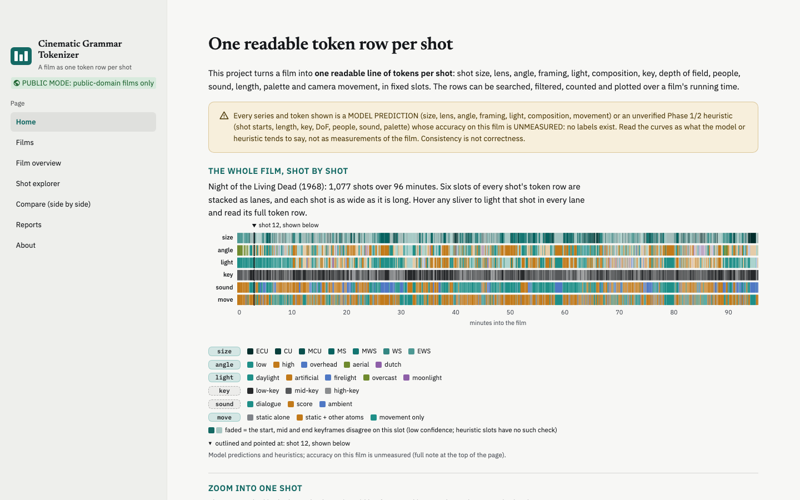

# Cinematic Grammar Tokenizer

**Live demo:** https://jahoi12345.github.io/cinematic-grammar-tokenizer/app/ &nbsp;·&nbsp; **Report:** https://jahoi12345.github.io/cinematic-grammar-tokenizer/

Film teachers, editors and critics describe shots in a shared vocabulary: close-up or wide shot, low or high angle, hard or soft light,
a pan or a push-in, a long take or a quick cut. This project turns a whole feature film into that vocabulary automatically, as **one
readable line of tokens per shot**. Every row has the same thirteen slots in the same order, so a film becomes something you can search
("every low-angle close-up"), count ("how much of the last act is in close shots") and plot over its running time. Static attributes come
from a vision-language model (Qwen3-VL-4B with a LoRA adapter fine-tuned on the public ShotQA set), camera movement from an
optical-flow and depth model, and the remaining slots from pretrained detectors and rules. The case study is the public-domain film
*Night of the Living Dead* (1968): 1,077 shots, one row each.



## A token row

Shot 538 of *Night of the Living Dead*, at 51:00:

```
00538 051:00.0 [size=MCU | lens=medium | angle=low | framing=single | light=artificial*/hard* | comp=center* | key=mid-key | DoF=medium | people=1 | sound=ambient | len=2-4s | palette=g20 | move=push-in+boom-up+tilt-down+move-left]
```

| slot | records | source |
|---|---|---|
| size, lens, angle, framing, light, comp | shot size, focal length, camera angle, framing, light type/condition, composition | fine-tuned vision-language model |
| key | low-, mid- or high-key | luminance histogram rule |
| DoF | depth of field | depth model and blur rule |
| people | people in frame, capped at 4+ | pretrained detector |
| sound | dialogue, score, ambient or silence | pretrained AudioSet classifier and grouping rule |
| len | shot length, seven bins | rule |
| palette | nearest of 32 global colour clusters | rule |
| move | set of camera-movement atoms (pan-left, push-in, static, ...) | geometry movement model |

A `*` marks a slot on which the shot's three keyframes (start, middle, end) disagree. **The rows are predictions:** no human labels exist
for this film yet, so their accuracy on it is unmeasured.

## Results

All benchmark runs were written down before they were run, sealed behind an evaluator that refuses uncommitted code, and logged in a
single-use ledger. Full details, intervals and every caveat are in the [report](https://jahoi12345.github.io/cinematic-grammar-tokenizer/) ([PDF](site/paper_public.pdf)).

### Static attributes (ShotBench, 3,108 four-option questions; chance 25%)

| model | scoring | seven-attribute mean |
|---|---|---|
| Qwen3-VL-2B + LoRA (earlier model) | letter logits | 73.2% |
| Qwen3-VL-4B + LoRA (used on the film) | letter logits | 75.06% |
| Qwen3-VL-2B + LoRA | official prompt and parser (matched protocol) | 73.26% [71.73, 74.81] |
| Qwen3-VL-4B + LoRA | official prompt and parser (matched protocol) | 74.71% [73.17, 76.25] |
| ShotVL-3B (published) | ShotBench paper | 66.83% |
| GPT-4o (published) | ShotBench paper | 60.84% |

Published values are the unweighted means of the ShotBench paper's seven static columns. Under the official protocol both of our means are
*above* the published ShotVL-3B and GPT-4o means by a rule fixed before the runs (our lower bound exceeds the published value; lighting type
is only comparable to ShotVL-3B). That statement comes with caveats: the published numbers are copied, not rerun; ShotQA, our only training
data, shares 202 of ShotBench's 242 films; ShotBench had been looked at before these runs; no paired test is possible; our models are
supervised fine-tuning only, while ShotVL-3B adds reinforcement learning (GRPO); our runs used a different inference engine and no GPT-4o
fallback parser; and the 4B checkpoint was selected on ShotQA validation. It is not a claim of general superiority or of accuracy on films.

On film-held-out ShotQA validation the 4B scores 82.49% against the 2B's 81.16%; with every image replaced by flat grey the 2B falls to
35.06%, so the accuracy comes mostly from the picture.

### Camera movement (option-restricted accuracy)

| test set | geometry model | video model | combined |
|---|---|---|---|
| ShotBench movement (464 questions) | **74.6%** | 56.7% | 76.9% |
| CameraBench public test, generated questions (934) | **62.6%** | 32.0% | 56.2% |

The pre-registered hypothesis that the combined model is better than either part was **not supported** (ShotBench gain interval includes zero;
worse on CameraBench), so the film rows use the geometry model alone. The CameraBench questions were produced by a fixed algorithm and are
not comparable with published CameraBench results.

### On the film

The cut detector found 1,077 shots at a threshold of 12 (the default of 27 finds only 368 on a black-and-white film); 47 of 50 hand-checked
cuts were real. Every key stage reproduced byte for byte on re-runs. What the rows cannot yet say is how often each slot is right on this
film: that needs labels.

## How it works

1. **Shots.** PySceneDetect's content detector with a per-film threshold; three keyframes per shot; colour, brightness and tonal-key
   features.
2. **Pretrained slots.** People (YOLO11n), depth of field (Depth-Anything-V2 plus a blur ratio), sound (an AudioSet classifier grouped into
   four classes, with timestamp-aligned audio).
3. **Static attributes.** The fine-tuned vision-language model scores every label of each attribute's full vocabulary on each keyframe; a
   shot's label is the highest mean probability over its three keyframes.
4. **Movement.** Optical-flow and depth-parallax features with one logistic regression per movement atom.
5. **Token rows.** One fixed-order row per shot, written to a Parquet table and a text file.

Each stage adds columns to one shot table and is cached by film, configuration hash and model version, so a change re-runs exactly the
stages that depend on it.

## The demo

The live demo is a static site (plain HTML, CSS and JavaScript, no server) published with the report on GitHub Pages:
https://jahoi12345.github.io/cinematic-grammar-tokenizer/app/. It has a Home page with the whole film as a grammar barcode, a film overview with its charts and visual arc, a shot explorer
with keyframes and filters on any slot, "shots like this", a comparison page, reports and an about page. Its files are in `app/static/`;
the data under `app/static/data/` is generated from the bundled token table by `scripts/build_static_app.py` (public-domain films only),
and `scripts/assemble_pages_site.py` (run by `.github/workflows/pages.yml`) puts the report at the site root and the demo with its
keyframes from `demo_data/` under `app/`. Charts are drawn with Vega-Lite (vega-embed, pinned versions loaded from cdn.jsdelivr.net).

To rebuild the demo data after a change to the token table or the chart code:

```
pip install -r requirements.txt
PYTHONPATH=src python scripts/build_static_app.py --root demo_data
```

### Run the interactive version locally

The same demo also runs as a Streamlit app on your own machine:

```
python3.12 -m venv .venv && . .venv/bin/activate
pip install -r requirements.txt
streamlit run streamlit_app.py
```

`streamlit_app.py` always runs in public mode on the bundled `demo_data/` (the token table and keyframes of *Night of the Living Dead*
only). Besides the pages above, it offers a CSV download of the filtered rows.

## Run the pipeline

```
uv sync --group dev --group ml --group demo --group vlm     # or: make setup-ml
uv run python scripts/download_models.py                    # pretrained detectors and depth/audio models
uv run python scripts/tokenize_video.py path/to/film.mp4 --dry-run
uv run python scripts/tokenize_video.py path/to/film.mp4 --cut-threshold 12
```

The run writes `data/processed/<id>_tokens_v1.parquet` and `.txt`. The static-attribute stage needs a ShotQA-trained LoRA adapter, which
is **not included** (ShotQA is licensed CC-BY-NC-ND, so nothing trained on it is redistributed); the training scripts are in `scripts/`
(`p3b_train.py`, `stepc_train.py`) for anyone with their own copy of ShotQA. Tests: `uv run pytest -q -m "not ml"`.

## Data, models and licences

- **Code:** MIT (see `LICENSE`).
- ***Night of the Living Dead*** (1968) is in the public domain; the keyframes in `demo_data/` come from it.
- **ShotQA** (training) and **ShotBench** (test only) are from the ShotBench project (arXiv:2506.21356). ShotQA is CC-BY-NC-ND: no
  ShotQA-derived model weights, adapters, classifier heads or the fitted colour palette are included. No benchmark questions or answers
  are included.
- **CameraBench** public test set (test only); not included.
- **Model weights are not included.** Qwen3-VL, SigLIP, YOLO11n, Depth-Anything-V2 and the AudioSet classifier are downloaded from their
  publishers under their own licences.

## Author

James Li, independent project, fall 2026. Each change was checked by a separate verification pass that did not write it.
