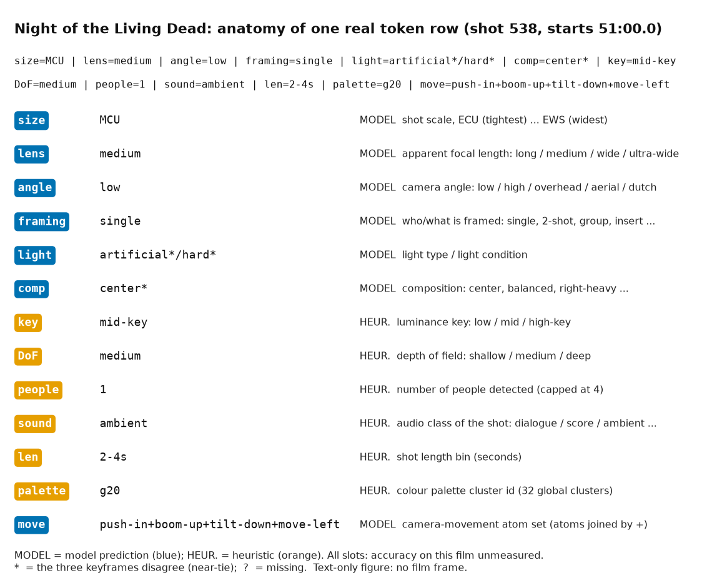
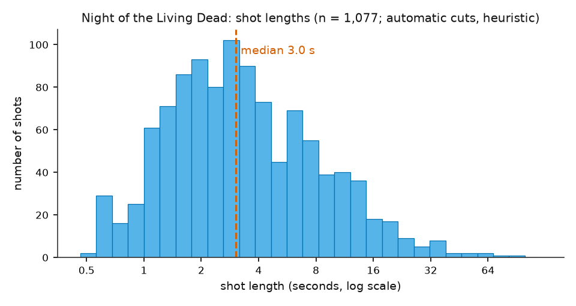
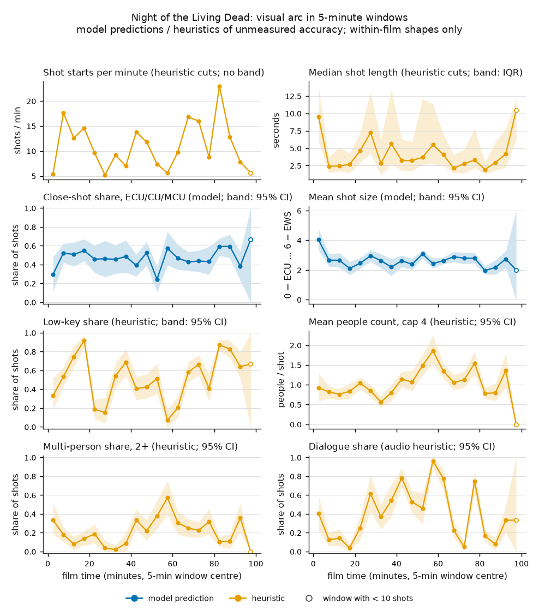
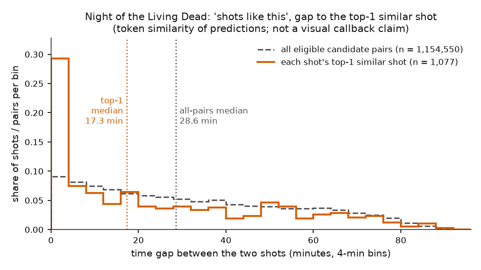

# Cinematic Grammar Tokenizer: write-up

Draft 6 (public version), 2026-10-28: section 4.3 now reports the official-protocol (matched) ShotBench results of the 2B and the 4B with all their caveats. Draft 5 (2026-10-22): the film pipeline's static model is the Qwen3-VL-4B adapter; 2026-10-27: section 4.3 gained the ShotBench paper's published Table 2 as context. Every draft was checked by a separate verification pass that did not write it.

**How to read this draft.** Every number is followed by its source in square brackets (a path when the file ships with this repository); unsourced numbers were left out. Nothing here says our tools are accurate on our film: we have no labels for it yet. Nothing here claims that we are better than GPT-4o, ShotVL or any other published system. Section 4.3 lists the ShotBench paper's published results as context, with our rows set apart and not ranked; under the official protocol our scores are called "above" a published number only where our lower bound exceeds it, and "comparable" otherwise [not included in this repository].

## Abstract

We built a tool that turns a film into one readable line of tokens per shot, a *token row*, with fixed slots from shot size and camera angle to lighting, sound and camera movement. Static attributes come from a vision-language model fine-tuned on ShotQA, a public question set about film stills and clips: since 2026-10-22 a Qwen3-VL-4B adapter, which replaced an earlier Qwen3-VL-2B adapter [not included in this repository]; movement comes from optical-flow and depth features; the remaining slots come from pretrained detectors and rules. On ShotBench, a public four-option test benchmark, the earlier 2B model scores 73.2% on static questions under our own scorer [not included in this repository]; the 4B scores 82.49% against the 2B's 81.16% on film-held-out ShotQA validation [results/stepc/selection.md], and on ShotBench, in the same letter-logit scoring, 75.06% with its letter logits alone (descriptive) and 75.14% with a SigLIP blend [not included in this repository]; on ShotBench's camera-movement questions the geometry model scores 74.6% [not included in this repository], and the pre-registered claim that a combined model is better than either part was not supported. Under ShotBench's official prompt and answer parser, the seven-attribute mean is 73.26% [71.73, 74.81] for the 2B [not included in this repository] and 74.71% [73.17, 76.25] for the 4B [results/p3m_matched/shotbench_matched_4b_v1_compare.json], above the published ShotVL-3B (66.83) and GPT-4o (60.84) seven-column means by a rule fixed before the runs; these are comparisons with published numbers, not reruns, ShotQA shares 202 of 242 films with ShotBench, the benchmark had been looked at before, no paired test is possible, our models are supervised fine-tuning only, and the 4B checkpoint was selected on ShotQA validation (section 4.3). We ran the pipeline over *Night of the Living Dead* (1968) and describe its visual arc. Accuracy on our own film is unmeasured, because our label sets are not labelled yet. Every benchmark run was pre-registered and sealed, each model was scored once, and every change was checked by a separate verification pass that did not write it.

---

## 1. Motivation, and what a "shot token row" is

Film students describe shots in a shared vocabulary: subject size, camera position and movement, lighting, length. By hand this is slow: *Night of the Living Dead* has 1,077 shots at our cut setting [not included in this repository].

A **token row** is one readable line per shot: fixed slots in a fixed order, each with a fixed vocabulary [not included in this repository]. The version we built ("v1") has 13 slots and no style slot [configs/tokens.yaml]: size, lens, angle, framing, light, comp (composition), key, DoF (depth of field), people, sound, len (length bin), palette and move. Three real rows from *Night of the Living Dead*, taken at the 25%, 50% and 75% positions of its 1,077-shot table rather than picked by content [results/phase6/notld_token_rows_sample.md] (shot id, start time, row):

```
00269 022:14.5 [size=MCU | lens=ultra-wide | angle=low | framing=single | light=artificial*/hard* | comp=right-heavy | key=mid-key | DoF=deep | people=1 | sound=score | len=4-8s | palette=g21 | move=static]
00538 051:00.0 [size=MCU | lens=medium | angle=low | framing=single | light=artificial*/hard* | comp=center* | key=mid-key | DoF=medium | people=1 | sound=ambient | len=2-4s | palette=g20 | move=push-in+boom-up+tilt-down+move-left]
00807 074:42.3 [size=CU* | lens=long* | angle=low* | framing=insert* | light=artificial/high-contrast | comp=right-heavy* | key=low-key | DoF=shallow | people=0 | sound=ambient | len=2-4s | palette=g21 | move=pull-out+boom-up+tilt-up]
```

(Rows exactly as committed, from the 4B token table [results/phase6/notld_token_rows_sample.md]; with the earlier 2B model shots 269 and 538 read daylight in place of artificial light, and shot 807 high angle and single framing [results/phase6/notld_token_rows_sample.md]; a change, not a proven improvement.) **These rows are predictions of unmeasured accuracy.** A `*` means the shot's three keyframes (start, middle and end frame) disagree on that slot [results/phase6/notld_token_rows_sample.md]. Shot 538's start time prints as `051:00.0` since a formatting bug that printed `050:60.0` was fixed [results/phase6/notld_token_rows_sample.md].



*Figure 4. One real token row of Night of the Living Dead (shot 538, the median-position row of the deterministic sample), with each of its 13 slots labelled as a model prediction or a heuristic. `*` marks a value on which the three keyframes disagree; `?` a missing value* [docs/writeup/figures/figures.md].

Film terms: sizes run from extreme close-up and close-up (ECU, CU) through medium close-up and medium shot (MCU, MS) to medium wide, wide and extreme wide shots (MWS, WS, EWS); low-key means mostly dark; score means film music. Rows can be searched, counted and compared without rewatching the film. Two warnings:
- The model slots (size, lens, angle, framing, light, comp, move) are **predictions of unmeasured accuracy** on our film. The models were tested on benchmarks of modern colour films, and NOTLD is a 1968 black-and-white film.
- The other slots (key, DoF, people, sound, len, palette) come from rules and pretrained detectors whose thresholds are guesses, not checked against labels [not included in this repository].

## 2. Data

### 2.1 Our film

- ***Night of the Living Dead* (1968), public domain.** A clean file: 5,731.8 s, decoded end to end with zero errors [not included in this repository]. Because it is black and white, the cut detector's default setting found only 368 shots; threshold 12 gives 1,077 [not included in this repository].

An early requirement of ten films by three or more directors was removed [not included in this repository], and the "director fingerprint" analysis was dropped with it [not included in this repository].

### 2.2 Training data: ShotQA

ShotQA has about 70k question-answer pairs about film stills and clips [not included in this repository]; all training uses it and nothing else. For still images we split it **by film**: 71 of 706 films (5,120 images) held out for validation, 44,597 training images, no film on both sides [not included in this repository]. For movement we used 1,058 clips from 129 source videos, holding out 19 sources [not included in this repository]. ShotQA is licensed CC-BY-NC-ND, so nothing trained on it (adapters, heads, codebooks, the global palette) is committed or redistributed [not included in this repository].

### 2.3 Test data: ShotBench and CameraBench (test only, single use)

- **ShotBench**: 3,572 questions (3,049 images, 464 videos), one test split, never used for training or tuning [not included in this repository]. We use its 3,108 static four-option questions [not included in this repository] and its 464 movement questions [not included in this repository].
- **CameraBench** public test: 1,071 GIFs, bytes independently verified [not included in this repository]. Instead of its native format we generated four-option questions with a pre-registered algorithm: 934 questions after 137 clips without a mapped label were dropped [not included in this repository].

**Single-use ledger.** Each finished model is evaluated on a test set once, and each evaluation writes a ledger line. The ShotBench still-image ledger has six entries: two Phase 3A probes, the Phase 3B (2B) model, one further sealed run of that frozen model under a different scoring protocol, and two runs of the 4B, one under that other protocol and one letter-logit with a SigLIP blend (section 4.3) [not included in this repository]. The two runs under the other protocol, ShotBench's official prompt and answer parser, are reported in section 4.3 with their caveats. ShotBench has therefore been looked at repeatedly, which weakens every later number a little. The Phase 4 ledger has six lines, three models times two test sets [not included in this repository].

### 2.4 Our own label sets

A 300-shot gold set (final reporting only) and a dev set of about 100 shots (for tuning thresholds) are committed as shot lists, but **neither is labelled yet** [not included in this repository]. This is why we cannot report accuracy on our film (section 9).

## 3. The pipeline

Each phase adds columns to a shot table with one row per shot; stages are cached by film, configuration hash and model version [not included in this repository]. One command, `scripts/tokenize_video.py`, runs every stage on any video file [not included in this repository].

- **Phase 1, shots, colour and rhythm.** PySceneDetect's ContentDetector finds cuts with a set threshold. For each shot we take three keyframes (start, middle, end) and compute a five-colour LAB palette, saturation, brightness, warm/cool balance, contrast, a lighting "key" from the luminance histogram, and the length [not included in this repository].
- **Phase 2, pretrained models and rules** [not included in this repository]: depth of field from Depth-Anything-V2-Small plus a blur ratio; people count, thirds position and headroom from YOLO11n; faces, facing and light direction from YuNet; sound class (dialogue, score, ambient, silence) by grouping the AudioSet AST classifier's top labels; subtitle text per shot.
- **Phase 3, static attributes.** 3A: a frozen SigLIP-base encoder with small heads per attribute [not included in this repository]. 3B: Qwen3-VL-2B-Instruct with a rank-16 LoRA adapter (small trainable low-rank weights added to a frozen model), trained for one epoch on the ShotQA film-split training set (51,111 samples, 3,195 updates) on an M2 Max laptop [not included in this repository], in 7.7 hours [not included in this repository]. The base model was the fastest candidate in a gating benchmark (0.581 s per step, 6.5 GB peak memory) [not included in this repository]; the checkpoint was chosen by a pre-registered rule on film-held-out validation, then frozen and hashed before its ShotBench evaluation [not included in this repository]. 3C: a film has no answer options, so labels come from the whole vocabulary. Seven scoring methods were compared on a 1,498-question validation subset under a pre-registered rule, which picked method D (all labels listed as letters in one question per attribute) [not included in this repository]. Each shot's label is the argmax of the mean probability over its three keyframes, a rule fixed before any labels existed [not included in this repository].
- **Phase 3, Step C: the 4B model, now the film default.** The same recipe applied to the larger Qwen3-VL-4B-Instruct (fresh rank-16 LoRA, one epoch, 3,195 updates on the same 51,111 training samples, on the same laptop) [not included in this repository]. On the deduplicated film-held-out validation set (5,822 questions) it scored 82.49% against 81.16% for the 2B, +1.33 points, film-clustered bootstrap 95% interval [+0.46, +2.18] (descriptive) [results/stepc/selection.md]. By a rule written before its ShotBench result, the film pipeline switched to the 4B single pass (pipeline version p3c-v2-4b, method D unchanged, no ensemble or SigLIP blend); the 2B outputs stay reproducible, and the token vocabulary is unchanged [not included in this repository]. *Night of the Living Dead* was re-tokenized with it [not included in this repository]. All film results in sections 6 and 7 come from the 4B tables.
- **Phase 4, camera movement.** Movement is a set of "atoms" (pan-left, push-in, static, ...). Three models were frozen before any test access [not included in this repository]: **geometry** (119 optical-flow and 112 depth-parallax features [not included in this repository], one logistic regression per atom, fitted on 903 ShotQA training clips); **video** (Qwen3-VL-2B with a LoRA adapter on 8 frames per clip); **combined** (0.3 x video + 0.7 x geometry, weights fitted on out-of-fold predictions) [not included in this repository]. Token rows use geometry only: every atom with probability at least 0.5, else the single top atom [not included in this repository].
- **Phase 5, the tokenizer** [not included in this repository]: soft vote over keyframes; seven fixed length bins (<1, 1-2, 2-4, 4-8, 8-16, 16-32, 32+ s); a global 32-colour palette fitted on ShotQA stills, never on the film being tokenized; people capped at "4+"; sound provisional; no confidence token. A learned "style" code was tried once and left out (section 4.5).

## 4. Results

### 4.1 Phase 1

- **Cut precision (50 random cuts, hand-checked).** NOTLD at threshold 12: 47 of 50 real, 94%, Wilson 95% interval about 84-98% [not included in this repository]. **Recall (missed cuts) was not measured.**
- **NOTLD shot counts by threshold:** 8 gives 1,217, 12 gives 1,077, 16 gives 970, 20 gives 812, 27 gives 368 [not included in this repository]. Figure 1 shows the length distribution.



*Figure 1. Distribution of the 1,077 automatically detected shot lengths of Night of the Living Dead (log-spaced bins, log seconds axis). Dashed line: median 3.0 s (interquartile range 1.7-6.1 s). Lengths depend on the cut detector; missed or false cuts move shots between bins* [docs/writeup/figures/figures.md].

### 4.2 Phase 2

Phase 2 ran on NOTLD, but **its accuracy is unmeasured**: thresholds are guesses and the dev labels are parked [not included in this repository]. Its synthetic tests caught 23 deliberate code mutations [not included in this repository].

### 4.3 Phase 3 (ShotBench static four-option questions)

**3A frozen SigLIP probe.** Seven-attribute mean 67.5% for the film-split model (designated primary) and 68.7% for the by-image model; the paper reports 60.8% for GPT-4o and 66.8% for ShotVL-3B on the same seven columns, under different protocols [not included in this repository].

**3B Qwen3-VL-2B LoRA (letter-logit scorer: the option letter the model scores highest is the answer).** Seven-attribute mean 73.2% (exact-count mean 73.16); chance is 25%; intervals are nominal Wilson intervals that ignore clustering by film [not included in this repository]:

| attribute (source: not included in this repository) | accuracy | correct / n | Wilson 95% |
|---|---|---|---|
| shot size | 85.6% | 415/485 | 82.2-88.4 |
| shot framing | 89.2% | 397/445 | 86.0-91.8 |
| camera angle | 79.3% | 361/455 | 75.4-82.8 |
| lens size | 67.3% | 329/489 | 63.0-71.3 |
| lighting type | 66.7% | 270/405 | 61.9-71.1 |
| lighting conditions | 58.3% | 204/350 | 53.1-63.3 |
| composition | 65.8% | 315/479 | 61.4-69.9 |

On film-held-out validation the adapter scored 81.16%; with every image replaced by flat grey it fell to 35.06%, against 25% chance and 45.67% for a label-prior baseline [not included in this repository]. The model uses the picture, but non-visual cues still carry some answers. Validation overstated the test result for lighting and composition by roughly 16 to 18 points [not included in this repository]. An erratum moved one lens question between answer strata (corrected lens strata 67.0% single-label, 80.0% label-set, 8 of 10); no headline number changed [not included in this repository].

**Step C Qwen3-VL-4B (the film model since 2026-10-22).** Validation: 82.49% vs 81.16% for the 2B (+1.33 [+0.46, +2.18]); per attribute 4B vs 2B: size 86.64/85.62, lens 67.56/67.44, angle 86.42/84.54, framing 88.67/87.25, lighting type 86.16/84.85, lighting conditions 76.72/74.14, composition 85.28/84.27 [results/stepc/selection.md]. The 4B was selected on this same validation set, so the gain is optimistic [not included in this repository]. On ShotBench the 4B had one sealed letter-logit run, combined with a small SigLIP blend chosen on validation ("C5"): seven-attribute mean 75.14% [73.64, 76.64] (bootstrap, 10,000 resamples stratified by attribute); in the same pass the 4B's letter logits alone gave 75.06% (descriptive, never selectable), against 73.16% for the 2B's letter-logit run, so the blend adds about 0.1 points [not included in this repository]. The film pipeline uses the 4B without the blend.

| attribute (source: the independent recompute of the 4B runs) | 2B letter-logit | 4B letter logits alone (descriptive) | 4B + SigLIP blend |
|---|---|---|---|
| shot size | 85.6% | 87.22% | 88.25% |
| shot framing | 89.2% | 90.11% | 91.01% |
| camera angle | 79.3% | 81.54% | 80.44% |
| lens size | 67.3% | 67.28% | 67.89% |
| lighting type | 66.7% | 70.12% | 70.12% |
| lighting conditions | 58.3% | 60.86% | 60.86% |
| composition | 65.8% | 68.27% | 67.43% |
| unweighted 7-attribute mean | 73.16 | 75.06 | 75.14 [73.64, 76.64] |

(2B column: project record, not included in this repository.) The 4B is about two points higher on ShotBench than the 2B in this scoring, but no paired test was pre-registered, ShotBench has now been looked at six times, and the 4B was chosen on validation; we do not call the difference significant.

**Published ShotBench results (Table 2 of the ShotBench paper).** For context, every model in Table 2 of the ShotBench paper (arXiv 2506.21356v2): 24 vision-language models and the paper's ShotVL-3B, with its seven static columns, our unweighted mean of those seven (camera movement excluded; the paper's own Avg includes it), and camera movement shown separately, sorted by the seven-column mean. These are published numbers, transcribed and not rerun [results/phase3/shotbench_published_table2.json]. SS shot size, SF framing, CA angle, LS lens size, LT lighting type, LC lighting conditions, SC composition, CM camera movement. The paper's printed Avg for ShotVL-3B (65.1) is not the unweighted mean of its eight columns (64.94); every other row matches [results/phase3/shotbench_published_table2.json].

| # | model (source: results/phase3/shotbench_published_table2.json) | group | SS | SF | CA | LS | LT | LC | SC | 7-column mean | CM (separate) |
|---|---|---|---|---|---|---|---|---|---|---|---|
| 1 | ShotVL-3B | ShotVL (paper's model) | 77.9 | 85.6 | 68.8 | 59.3 | 65.7 | 53.1 | 57.4 | 66.83 | 51.7 |
| 2 | GPT-4o | proprietary | 69.3 | 83.1 | 58.2 | 48.9 | 63.2 | 48.0 | 55.2 | 60.84 | 48.3 |
| 3 | Qwen2.5-VL-72B-Instruct | open | 75.1 | 82.9 | 56.7 | 46.8 | 59.0 | 49.4 | 54.1 | 60.57 | 48.9 |
| 4 | InternVL3-38B | open | 68.0 | 84.0 | 51.9 | 43.6 | 64.4 | 46.9 | 54.7 | 59.07 | 44.6 |
| 5 | InternVL2.5-38B | open | 67.8 | 85.4 | 55.4 | 41.7 | 61.7 | 48.9 | 52.4 | 59.04 | 44.0 |
| 6 | InternVL3-78B | open | 69.7 | 80.0 | 54.5 | 44.0 | 65.5 | 47.4 | 51.8 | 58.99 | 44.4 |
| 7 | Qwen2.5-VL-7B-Instruct | open | 69.1 | 73.5 | 53.2 | 47.0 | 60.5 | 47.4 | 49.9 | 57.23 | 30.2 |
| 8 | Qwen2.5-VL-32B-Instruct | open | 62.3 | 76.6 | 51.0 | 48.3 | 61.7 | 44.0 | 52.2 | 56.59 | 43.8 |
| 9 | InternVL3-14B | open | 59.6 | 82.2 | 55.4 | 40.7 | 61.7 | 44.6 | 51.1 | 56.47 | 38.2 |
| 10 | Gemini-2.5-flash-preview-04-17 | proprietary | 57.7 | 82.9 | 51.4 | 43.8 | 65.2 | 45.7 | 45.9 | 56.09 | 43.5 |
| 11 | LLaVA-Onevision-Qwen2-7B-Ov-Chat | open | 58.4 | 71.0 | 52.3 | 38.7 | 59.5 | 44.9 | 50.9 | 53.67 | 39.7 |
| 12 | InternVL2.5-8B | open | 56.3 | 70.3 | 50.8 | 41.1 | 60.2 | 45.1 | 50.1 | 53.41 | 33.6 |
| 13 | InternVL3-8B | open | 62.1 | 65.8 | 46.8 | 42.9 | 58.0 | 44.3 | 46.8 | 52.39 | 44.2 |
| 14 | Gemini-2.0-flash | proprietary | 48.9 | 75.5 | 44.6 | 31.9 | 62.2 | 48.9 | 52.4 | 52.06 | 47.4 |
| 15 | LLaVA-Video-7B-Qwen2 | open | 56.9 | 65.4 | 45.1 | 36.0 | 63.5 | 45.4 | 37.4 | 49.96 | 35.3 |
| 16 | Qwen2.5-VL-3B-Instruct | open | 54.6 | 56.6 | 43.1 | 36.6 | 59.3 | 45.1 | 41.5 | 48.11 | 31.9 |
| 17 | InternVL3-2B | open | 56.3 | 56.0 | 44.4 | 34.6 | 56.8 | 44.6 | 43.0 | 47.96 | 38.1 |
| 18 | Internlm-xcomposer2d5-7B | open | 51.1 | 71.0 | 39.8 | 32.7 | 59.3 | 35.7 | 35.7 | 46.47 | 38.8 |
| 19 | VILA1.5-13B | open | 36.7 | 54.6 | 40.7 | 34.8 | 52.8 | 35.4 | 34.2 | 41.31 | 31.3 |
| 20 | VILA1.5-8B | open | 40.6 | 44.5 | 39.1 | 29.7 | 48.9 | 32.9 | 34.4 | 38.59 | 36.9 |
| 21 | VILA1.5-3B | open | 33.4 | 44.9 | 32.1 | 28.6 | 50.6 | 35.7 | 28.4 | 36.24 | 21.5 |
| 22 | LLaVA-NeXT-Video-7B | open | 35.9 | 37.1 | 32.5 | 27.8 | 50.9 | 31.7 | 28.0 | 34.84 | 31.3 |
| 23 | Ovis2-8B | open | 35.9 | 37.1 | 32.5 | 27.8 | 50.9 | 31.7 | 28.0 | 34.84 | 35.3 |
| 24 | Instructblip-vicuna-7B | open | 27.0 | 27.9 | 34.5 | 29.4 | 44.4 | 29.7 | 27.1 | 31.43 | 25.0 |
| 25 | Instructblip-vicuna-13B | open | 26.8 | 29.2 | 27.9 | 28.0 | 39.0 | 24.0 | 27.1 | 28.86 | 22.0 |
| | ***This project (not in Table 2; not ranked)*** | | | | | | | | | | |
| | **Ours: 4B, letter-logit (VLM only)** [not included in this repository] | ours | 87.22 | 90.11 | 81.54 | 67.28 | 70.12 | 60.86 | 68.27 | **75.06** | n/a (see notes) |
| | **Ours: 4B, official protocol (matched)** [results/p3m_matched/shotbench_matched_4b_v1_compare.json] | ours | 86.39 | 90.34 | 78.90 | 66.67 | 70.12 | 63.14 | 67.43 | **74.71 [73.17, 76.25]** | n/a (see notes) |
| | **Ours: earlier 2B, official protocol (matched)** [not included in this repository] | ours | 85.36 | 88.99 | 78.90 | 66.26 | 68.15 | 59.43 | 65.76 | **73.26 [71.73, 74.81]** | n/a (see notes) |

How to read our rows (they are not a ranking):

- **Different protocol.** The letter-logit row reads the option letter the model scores highest (letter-logit scoring); the paper's numbers come from its VLMEvalKit prompt and answer parser with a GPT-4o extraction fallback [not included in this repository]. Part of any gap may come from scoring rather than from the models.
- **Published, not rerun.** None of the 25 published models was run by us [results/phase3/shotbench_published_table2.json].
- **Shared films.** ShotQA, our only training data, shares 202 of the 242 films listed for ShotBench [not included in this repository].
- **Selection.** The 4B checkpoint was selected on ShotQA validation [results/stepc/selection.md], and its ShotBench run came after earlier looks at the same questions [not included in this repository].
- **No paired test.** Per-question outputs of the published models are not available; the letter-logit row is a point value from one run, the official-protocol rows are intervals compared with published point values.
- **Different training.** Our models are supervised fine-tuning only (LoRA adapters on ShotQA); ShotVL-3B adds reinforcement learning (GRPO) on top of supervised fine-tuning, and the other 24 are general models evaluated as released [not included in this repository].
- **Camera movement is a different model.** The CM column has no entry for our rows: movement comes from our separate geometry model, 74.6% on ShotBench's movement questions [not included in this repository], which is not part of the seven-column mean.
- **Official-protocol rows.** They use the paper's official prompt and answer parser, but no GPT-4o fallback parser (an unparseable answer counts as wrong; there were 0) and a different inference engine (MLX on Apple silicon, image budget 147,456 pixels) [not included in this repository] [results/p3m_matched/shotbench_matched_4b_v1_compare.json].

**Official ShotBench protocol (matched, a recorded decision).** Our letter-logit scorer is not the paper's protocol, so each frozen model was evaluated once more with the official user prompt and answer parser, greedy decoding up to 1,024 new tokens and the reasoning prompt variant, on all 3,108 static questions; ShotVL-3B itself was not downloaded or run, and the wording rule was written before the first run [not included in this repository]. On validation the protocol switch moved the 2B's mean by -0.09 and -0.29 points, neither detectable [not included in this repository]. Intervals are 10,000 bootstrap resamples stratified by attribute (seed 0); a verdict is "above" only where our lower bound exceeds the published number, "below" only where our upper bound is under it, otherwise "comparable" [not included in this repository].

| attribute [results/p3m_matched/shotbench_matched_4b_v1_compare.json] [not included in this repository] | 4B, matched [95% CI] | 2B, matched [95% CI] | ShotVL-3B (published) | verdict 4B / 2B | GPT-4o (published) | verdict 4B / 2B |
|---|---|---|---|---|---|---|
| shot size | 86.39 [83.30, 89.28] | 85.36 [82.06, 88.45] | 77.9 | above / above | 69.3 | above / above |
| shot framing | 90.34 [87.42, 93.03] | 88.99 [86.07, 91.69] | 85.6 | above / above | 83.1 | above / above |
| camera angle | 78.90 [75.16, 82.64] | 78.90 [75.16, 82.64] | 68.8 | above / above | 58.2 | above / above |
| lens size | 66.67 [62.58, 70.76] | 66.26 [61.96, 70.55] | 59.3 | above / above | 48.9 | above / above |
| lighting type | 70.12 [65.68, 74.57] | 68.15 [63.70, 72.59] | 65.7 | comparable / comparable | 63.2 | above / above |
| lighting conditions | 63.14 [58.29, 68.29] | 59.43 [54.29, 64.86] | 53.1 | above / above | 48.0 | above / above |
| composition | 67.43 [63.26, 71.61] | 65.76 [61.38, 69.94] | 57.4 | above / above | 55.2 | above / above |
| unweighted 7-attribute mean | **74.71 [73.17, 76.25]** | **73.26 [71.73, 74.81]** | 66.83 | above / above | 60.84 | above / above |

Under the official protocol both seven-attribute means are above the published ShotVL-3B and GPT-4o seven-column means; lighting type is only comparable to ShotVL-3B for both models (the 4B's lower bound misses 65.7 by 0.02 points), and two 2B margins sit close to the boundary (lighting conditions against ShotVL-3B, 54.29 against 53.1; lighting type against GPT-4o, 63.70 against 63.2) [not included in this repository] [results/p3m_matched/shotbench_matched_4b_v1_compare.json]. Applying the same rule to the other 23 published models is our extension after the fact, on the seven-column mean only: both matched lower bounds (73.17 and 71.73) exceed all 25 published seven-column means, the highest being ShotVL-3B's 66.83 [results/phase3/shotbench_published_table2.json]. The 4B is about 1.5 points higher than the 2B under this protocol; the intervals overlap and no paired test was pre-registered, so this is a description. These statements hold only with every caveat below [not included in this repository]:

- **Published, not reruns.** ShotVL-3B's and GPT-4o's numbers are copied from the paper; ShotVL's inference engine and whether it used the reasoning prompt are unconfirmed, and the paper used a GPT-4o fallback parser that we did not.
- **Repeated looks.** The 2B's matched run was its second look at ShotBench (the letter-logit 73.2% stays reported unchanged); the 4B's matched run was the fifth look at the static questions and its letter-logit run the sixth [not included in this repository].
- **Shared films.** Our models and ShotVL-3B are trained on ShotQA, which shares 202 of 242 films with ShotBench [not included in this repository].
- **No paired test** is possible, because the published models' per-question outputs are not available.
- **Different training.** Ours are supervised fine-tuning only (2 and 4 billion parameters); ShotVL-3B has 3 billion with supervised fine-tuning plus reinforcement learning (GRPO); GPT-4o is zero-shot.
- **Selection.** The 4B checkpoint was selected on the ShotQA validation set [results/stepc/selection.md].
- **Seven static columns only.** 66.83 and 60.84 are our unweighted means of the paper's seven static columns, not its headline average, which includes camera movement.

We therefore do not claim that either model is generally better than ShotVL-3B or GPT-4o, that the 4B is better than the 2B on films, or anything about films outside ShotBench.

**What did not help (2026-10-17 to 2026-10-22).** The 4B was the one real gain of the last week; the other attempts are reported so they are not mistaken for silence. An inference ensemble (Step A) gained +1.21 validation points on the 2B [not included in this repository], but on the 4B about 97% of its gain came from the SigLIP blend alone, which then added about 0.1 points on ShotBench, so it is not the default [not included in this repository]. Retraining with CineScale2 data (Step B) did not pass its pre-registered bar (best 81.68 vs a bar of 81.73) [not included in this repository]. An eye-level head looked eligible but learned a source artifact: 97.2% of CineScale2's eye-level training images have one frame size, and frame size alone nearly matches the head [not included in this repository], so the vocabulary still has no eye-level class. Augmentation, a doubled image budget and extra steps on the 4B (step 3) all stayed within noise (best +0.19, interval spanning zero) [not included in this repository]. A small GRPO pilot (325 updates) left validation unchanged (82.43 vs 82.49) while making the model more confident [not included in this repository].

**3C full-vocabulary scoring.** Method D scored a composite of 71.2, inside the pre-registered 1.0-point band of the best method (A3m, 71.6); the tie rule picks the fewest passes [not included in this repository]. Full-vocabulary scores run 3 to 10 points below four-option accuracy, and 6 to 9 of 51 labels are never predicted, on our film and on validation alike, so this is largely a property of the model [not included in this repository].

### 4.4 Phase 4 (camera movement, six sealed evaluations)

| test set (source: not included in this repository) | geometry | video | combined |
|---|---|---|---|
| ShotBench movement (464 q.) | 74.6% (346/464), 70.4-78.3 | 56.7% (263/464), 52.1-61.1 | 76.9% (357/464), 72.9-80.5 |
| CameraBench generated (934 q.) | 62.6% (585/934), 59.5-65.7 | 32.0% (299/934), 29.1-35.1 | 56.2% (525/934), 53.0-59.4 |

Option-restricted accuracy with nominal Wilson 95% intervals; a baseline answering from training label frequencies scores 41.4% and 26.6% [not included in this repository]. Paired differences, bootstrapped over source videos: combined minus geometry +2.4 points [-0.9, +5.4] on ShotBench and -6.4 [-9.8, -3.4] on CameraBench; video minus geometry -17.9 [-23.7, -12.8] and -30.6 [-35.1, -26.4] [not included in this repository].

**The pre-registered hypothesis "combined is better than either alone" is not supported** [not included in this repository]: the ShotBench gain over geometry includes zero, and on CameraBench the combination is worse than geometry. The video model transfers poorly: 68.9% out-of-fold, but 56.7% and 32.0% on the test sets; with grey frames it kept 84.5% of its validation accuracy (82/140 vs 97/140), suggesting it leans on cues in the question and options rather than on motion [not included in this repository]. The out-of-fold numbers (video 68.9%, geometry 77.5%, combined 82.8%) were optimistic, because the combination weights were fitted on the same questions [not included in this repository].

### 4.5 Phase 5 (tokenizer and the style experiment)

The v1 row was built for all 1,077 NOTLD shots and independently reproduced cell for cell [not included in this repository], with no `n/a` movement slot [not included in this repository]. The style code failed its pre-registered bars: healthy on ShotQA (all 256 level-1 codes used, perplexity about 248), but on NOTLD one level-1 code took 35.7% of the middle keyframes (bar: at most 10%), only 48 level-1 codes appeared, and a shot's three keyframes shared a code in 32.5% of shots (bar: 50%) [not included in this repository]. Style stays out of the row.

### 4.6 Phase 6

Power dynamics was **dropped** after one bounded attempt because speaker attribution was not reachable with local tools [not included in this repository]; the director fingerprint was dropped [not included in this repository].

### 4.7 The one-command entry point

On a 180 s NOTLD excerpt outside the film registry, the command ran all five stages and found 19 shots; 18 of 18 interior cuts matched the full-film cuts within one frame [not included in this repository]. On 17 matched shots the visual slots agreed 88-100% per slot, differences being near-ties [not included in this repository]; this is a consistency check, not accuracy. The sound slot agreed in only 47% [not included in this repository]; that exposed the audio defect of section 6.3, so the number is **superseded**.

The run also found two pipeline issues, none in the entry point itself: some music labels such as "Opera" fell into `ambient` (U1), and the GPU lock was held through CPU-only stages (U2); both are fixed [not included in this repository].

## 5. How the work was verified

**Pre-registration.** For Phases 3B, 3C and 4 the plan, hyper-parameters, selection and stopping rules were committed before the run, and changes were dated amendments [not included in this repository]. Mishaps were disclosed rather than quietly redone: an aborted first 3B launch, restarted from scratch [not included in this repository]; a 3C metric bug fixed after scores were visible, with the selection recomputed under the original metric (still D) [not included in this repository].

**Sealed evaluators and the ledger.** Test labels sat behind evaluators that refused uncommitted code and wrote one ledger line per evaluation [not included in this repository]. The six Phase 4 evaluations were run as a separate step from model development, after a separate verification pass had cleared the evaluator [not included in this repository], which had passed a synthetic self-check of 67/67 [not included in this repository] plus 55 CPU checks, 17 of 17 mutants killed, 50 sealing checks and a 20 of 20 validation replay [not included in this repository]. The 3B adapter hash was unchanged after evaluation [not included in this repository].

**Independent verification.** Each change was checked by a separate verification pass that did not write it, working in its own copy of the repository. Each pass committed its pass/fail checks before reading results, recomputed key evidence from original inputs, and mutated every claimed guard; nothing was merged without an accepted verdict from a pass that did not write it.

**Mutation checks.** Verification passes broke code on purpose and checked that a test failed. The audio-fix verification's five mutations found one guard the author's tests missed, and it added a test for it [not included in this repository]; the entry-point verification ran 13 of 13 checks [not included in this repository] and 23 mutations [not included in this repository].

**Byte-identical reproductions.** 3B: a 300-question validation replay gave 300 of 300 identical letters, maximum logit difference 0.0 [not included in this repository]. 3C: a full NOTLD re-run gave 0 disagreements in 22,617 score vectors [not included in this repository], and a GPU replay matched 630 of 630 vectors [not included in this repository]. The NOTLD movement table and token rows were byte-identical after a 2026-10-13 re-run [not included in this repository], and the movement probes replayed within 1e-6 [not included in this repository].

## 6. Case study: *Night of the Living Dead*

Everything here is **descriptive**: model series are predictions of unmeasured accuracy, heuristic series are unverified Phase 1 and 2 outputs, and all comparisons are within this one film [not included in this repository].

### 6.1 The film as a whole

From the 4B token table over 1,077 shots, three keyframes each, each shot's label being the soft vote over its keyframes [results/phase6/notld_writeup_numbers.json] (the earlier 2B numbers are in [not included in this repository]):
- **Size:** ECU to MS make up 68% of shots [results/phase6/notld_writeup_numbers.json], against 57% in the ShotQA prior [not included in this repository] (73% with the 2B).
- **Angle:** low 44%, high 38%, dutch 11% [results/phase6/notld_writeup_numbers.json]. The vocabulary has no eye-level class, so eye-level shots must land on low or high: an artifact, not tilted cameras [not included in this repository].
- **Light type:** daylight 48%, artificial 46% [results/phase6/notld_writeup_numbers.json], against 66% and 23% with the 2B [not included in this repository]; lighting is where the switch changed the film most (section 6.5). HMI, LED, tungsten and several other types are never the primary label [results/phase6/notld_writeup_numbers.json].
- **Keyframe agreement:** the four single-label attributes agree across keyframes in only 25% of shots, all seven in 9.0% (97 of 1,077) [results/phase6/notld_writeup_numbers.json] [not included in this repository]. Agreement is not correctness; low agreement means a label is what the model tends to say.
- **Heuristic cross-check** (agreement, not accuracy): with one person detected, the model says single, insert or over-the-shoulder framing in 90% of 556 shots [results/phase6/notld_writeup_numbers.json].

### 6.2 The visual arc

We cut the film into 20 five-minute windows (Figure 2); the series were recomputed on the 4B table, and only the model-based ones changed [not included in this repository].

- **Rhythm.** The three fastest windows are minutes 80-85 (23.0 shot starts per minute), 5-10 (17.6) and 65-70 (16.8); the three slowest are minutes 25-30 (5.2), 0-5 (5.4) and 55-60 (5.6). This matches an earlier Phase 1 observation, but uses the same cut table, so it is not independent evidence [not included in this repository].
- **Drift** (Spearman of a window series with window position; descriptive, not a test): predicted daylight share -0.44, predicted high-contrast share +0.21, heuristic low-key share +0.25 [not included in this repository] (2B: -0.43 and +0.31 for the two predicted series). Loosely, predicted daylight falls and contrast rises, with both models. This is not a narrative claim: nothing was tuned, accuracy is unknown, and the lighting-type series is implausibly volatile on this film [not included in this repository].
- **Robustness.** Series built from the middle keyframe only correlate 0.94 to 0.98 with the three-keyframe series [not included in this repository].
- **Movement.** 58.6% of shots have `static` in their set and 18.6% have `static` alone; the median set has 2 atoms; 42.9% of sets are contradictory (pan-left with pan-right, or static with motion), which no real camera produces [not included in this repository]; movement comes from the geometry model and did not change with the 4B. A behaviour check (not accuracy) is better: motion probability separates moving from static shots with AUC 0.973 [0.96, 0.983], though it uses the same optical flow the model sees [not included in this repository]. Under time reversal the model reads pan direction on confident shots (rho -0.632), but no direction pair reaches the "reads direction" band on the full probe subset [not included in this repository]. A separate verification pass accepted these probes with advisories [not included in this repository]; an older log line calling them unaccepted is superseded [not included in this repository].



*Figure 2. Night of the Living Dead in 20 five-minute windows: shot starts per minute, median shot length (band: within-window IQR), close-shot share, mean shot size (0 = ECU ... 6 = EWS), low-key share, mean people count (capped at 4), multi-person share and dialogue share (bands: 95% bootstrap intervals over the window's shots). Blue: model predictions; orange: heuristics. Hollow markers: windows with fewer than 10 shots (the last window is partial). Model predictions and heuristics of unmeasured accuracy; within-film shapes only; intervals describe resampling, not label accuracy* [docs/writeup/figures/figures.md].

### 6.3 Sound after the audio fix

All NOTLD sound numbers here are **post-fix**; earlier ones are **superseded**. The old decode ignored 36 timestamp gaps (14.8 s in total), so sound drifted later into the film: 0 s off at 60 s, -1.2 s at 900 s, -4.4 s at 1,800 s, -6.8 s at 3,600 s, -12.4 s at 5,400 s [not included in this repository]. After the fix an independent verification pass measured 0.000 s at all five points [not included in this repository]. The sound class changed in 282 of 1,077 shots (26.2%), all after the first gap at 639.7 s; nothing else changed [not included in this repository]. The sound-groups fix then changed the sound slot of 24 shots, 23 of them to score [not included in this repository]:

| sound class (source: not included in this repository) | share of runtime now | superseded: after audio fix |
|---|---|---|
| dialogue | 40.8% | 42.4% |
| score | 37.4% | 34.8% |
| ambient | 21.8% | 22.8% |

Earlier, pre-audio-fix values are in the project's experiment log (not included in this repository).

A recorded decision ordered the local NOTLD tables replaced [not included in this repository]; the swap was done in the pipeline copy of the repository [not included in this repository] and then in the main checkout [not included in this repository]. The arc was rerun on the corrected table: only dialogue share changed, its Spearman trend going -0.10, +0.04, now +0.03 (earlier values superseded), near zero throughout [not included in this repository]; a separate verification pass accepted the refresh [not included in this repository]. The sound slot stays provisional pending a 20-shot listening check [not included in this repository].

### 6.4 Shots like this

For each shot we found its most similar shot by token similarity and measured the time gap between them (Figure 3) [not included in this repository]. A high score means the pipeline wrote similar tokens, not that the shots look alike, and a long-range pair is not evidence of a deliberate visual callback [not included in this repository].



*Figure 3. For each of the 1,077 shots, the time gap to its most similar other shot by token similarity (solid line), against the gap of all 1,154,550 eligible candidate pairs (dashed line), as the share per 4-minute bin. Medians 17.3 min (top-1) and 28.6 min (all pairs); gaps of at most 1 min: 17.5% of top-1 partners vs 2.2% of all pairs (4B table; 18.3 min and 15.0% with the 2B). Equal slot weights are a choice; the reference is for scale only, with no test* [docs/writeup/figures/figures.md].

### 6.5 What the switch to the 4B changed

Of the 1,077 NOTLD shots, the 4B changed the primary label of lighting conditions in 574, lighting type in 295, size in 231, angle in 230, lens in 163, composition in 134 and framing in 88 [not included in this repository]; on an earlier 200-shot sample, 83.5% of shots changed at least one static slot [not included in this repository]. This is a change, not a proven improvement: accuracy on the film is unmeasured for both models, and the switch rests on benchmark evidence only [not included in this repository].

## 7. The demo (app v1.0)

A local Streamlit app (`app/demo/`) shows the token rows interactively [not included in this repository]. Since 2026-10-22 it reads the 4B token tables, and its About and Reports pages describe the 4B as the static model [not included in this repository]. Version 1.0 opens on an **About** page (what a token row is, the 13 slots, the `*` and `?` legend, the caveats); it has a wide layout, film titles, wrapped token rows and readable chart labels [not included in this repository]. The shot explorer filters by any token slot, shows the three keyframes and the readable row, and offers a **CSV download** of the filtered rows without keyframe file paths [not included in this repository]. An **Add your own clip** page, shown only when the app runs locally, shows the `scripts/tokenize_video.py` command and warns that the default cut threshold is unchecked; it has no upload and runs nothing [not included in this repository]. Every page says that its series and tokens are predictions or unverified heuristics of unmeasured accuracy [not included in this repository].

- **Public mode** (`CGT_DEMO_PUBLIC=1`) lists only films marked public domain in the committed registry (today NOTLD), fails closed if the registry cannot be read, and hides the Add-clip page [not included in this repository].
- **Verification.** A separate verification pass accepted the first version with no blockers [not included in this repository]. The v1.0 guards (CSV limited to the public film, Add-clip hidden in public mode) have written acceptance criteria [not included in this repository]. A hosted copy should hold only NOTLD data [not included in this repository].

## 8. Limitations and disclosures

These repeat, in substance, every item of the "Disclosures for any write-up" list in STATUS [not included in this repository], plus later ones.

1. **ShotBench is not film-disjoint from ShotQA.** 202 of 242 ShotBench films also supply ShotQA images (title match) [not included in this repository]. We removed 2,055 near-duplicate images [not included in this repository], but an audit sample still found one strong same-shot candidate in 32 test images; the residual effect is unknown [not included in this repository].
2. **The 3A film-split model was named primary after the by-image model's test result was known**; neither was chosen by test score, but the design was not blind to the first test result [not included in this repository].
3. **Supervised versus zero-shot is not like-for-like**: our models are trained on ShotQA, GPT-4o's numbers are zero-shot [not included in this repository].
4. **Different scoring.** 3B reads option letter logits; the paper decodes text with a GPT-4o extraction fallback; 3A ranks label sets [not included in this repository]; part of any difference may come from scoring.
5. **Phase 4 validation looks**: 6 logged plus 5 declared afterwards, not certifiable; validation selected nothing [not included in this repository].
6. **CameraBench overlap is a proxy**: 6 of 404 filename-derived source ids shared with ShotQA, film overlap unmeasured; 427 of 464 ShotBench movement videos share a source id with a ShotQA clip [not included in this repository].
7. **ShotQA is CC-BY-NC-ND**: models and artifacts trained on it are not redistributable [not included in this repository].
8. **Early CameraBench label access**: before it became test-only, a script read 20 sample labels and aggregate counts; nothing used them, and absence of other unlogged reads is not established [not included in this repository].
9. **Training interruptions**: the video cross-fitting run had 13 restarts, 12 of them Metal-watchdog kills, with documented trainer defects; the audit found none of the defect conditions occurred [not included in this repository].
10. **Generated CameraBench questions** are not the native protocol and not comparable with published CameraBench results [not included in this repository].
11. **Single runs**: one training run, one seed; run-to-run variation unknown [not included in this repository].
12. **Official-protocol rows** (section 4.3) are comparisons with published numbers, not reruns, after repeated looks at ShotBench, with shared films, no paired test, a different inference engine and no GPT-4o fallback parser [not included in this repository].
13. **Process breach disclosed**: two review commits and a few files were written around the repository's write-isolation guard [not included in this repository].
14. **Raw benchmark predictions contain gold answers** and must be scrubbed or hashed before any release [not included in this repository]. The scrubber and release checker are merged and verified (usage and checks: [not included in this repository]); the current tree still fails the checker by design, so no release has been made.
15. **Our film**: cut recall unmeasured; Phase 2 thresholds untuned; the NOTLD subtitle file is unreliable automatic speech recognition [not included in this repository]; pre-fix sound numbers superseded (section 6.3).
16. **The 4B was selected on ShotQA validation** and compared with the 2B on the same set; its first ShotBench run came after four earlier looks at the same questions (ledger: six entries in all) [results/stepc/selection.md] [not included in this repository]. No paired test of 4B against 2B on ShotBench was pre-registered, so "about two points higher" (letter logits) is a description, not a significance claim [not included in this repository].
17. **The switch changed the film a lot**: most lighting-condition slots and about a fifth of size and angle slots of NOTLD changed (section 6.5) without any measurement of which model is right on the film [not included in this repository]. The sealed gold scorer stays pinned to the old 2B table [not included in this repository].
18. **Earlier-model numbers**: section 4.3's 2B results, 4.4-4.7 and the Phase 3C validation numbers were produced with the 2B model and are reported unchanged; they describe that model, not the film default [not included in this repository].

## 9. What we cannot claim

- **No accuracy on our film.** Without labels we do not know how often any slot is right on NOTLD. Benchmark accuracy does not transfer: the benchmarks are modern colour films, NOTLD is 1968 black and white. Keyframe agreement and heuristic cross-checks are consistency, not accuracy.
- **No ranking against published systems.** Section 4.3 sets our rows apart from the ShotBench paper's 25 published results. Under the official protocol (74.71 and 73.26) the verdict "above" rests on a rule fixed before the runs and on every caveat listed there. The 4B letter-logit row (75.06) is a different protocol (letter logits vs the paper's prompt, parser and GPT-4o fallback), the published numbers were not rerun, ShotQA shares 202 of 242 films with ShotBench, the 4B was selected on ShotQA validation, no paired test is possible, and movement is a separate model [results/phase3/shotbench_published_table2.json] [not included in this repository]. No general "better than" claim, and no claim about films outside ShotBench. Phase 4 makes no comparison with published systems [not included in this repository].
- **No significant 4B-over-2B claim.** On ShotQA validation the 4B is +1.33 [+0.46, +2.18] [results/stepc/selection.md], but it was selected there; on ShotBench it is about two points higher in letter-logit scoring [not included in this repository] with no pre-registered paired test. Nor do we claim that the 4B's different film tokens are better (section 6.5).
- **Not like-for-like**: supervised versus zero-shot; letter logits versus text decoding; generated versus native CameraBench questions; our validation sets versus the benchmarks.
- **"Combined is better than either alone" is not supported**: it holds only against the video model [not included in this repository].
- **No claim of general cinematographic understanding**, no unseen-film performance claim, and no narrative reading of the arc without labels and a transcript [not included in this repository].

## 10. Next steps

1. **Labels.** Label the dev set (about 100 shots) and the 300-shot gold set, or a smaller labelled sample of film shots: the only way to know whether the 4B's token changes are improvements, to report accuracy on our film, tune Phase 2 on dev and test domain shift. Labelling is parked [not included in this repository].
2. **New inputs.** Hand-check about 50 cuts of any new input and re-run it with a checked threshold [not included in this repository].
3. **Demo**: address the remaining interface advisories; any hosted copy runs in public mode on a machine holding NOTLD data only.
4. **Model work**: no 8B model will be trained [not included in this repository]; a real GRPO run would need a new plan (for example dropping questions every sample already answers correctly, larger groups, several seeds) [not included in this repository]; a lens signal from field-of-view estimates or EXIF focal lengths is a hypothesis to test on training data only [not included in this repository]; more black-and-white films for the style code and the CameraBench training split stay parked [not included in this repository].
5. **Before any release**: scrub or hash raw predictions with benchmark answers, and keep every ShotQA-derived artifact out [not included in this repository].

## 11. Conclusion

We built a pipeline that turns any video file, with one command, into a table of shots and one token row per shot. Stages are cached, key runs were reproduced byte for byte, and every change passed a separate verification pass that did not write it.

What we can show is benchmark behaviour under strict rules: sealed, pre-registered evaluations, one per model, with intervals. On ShotBench's static questions the earlier 2B model reaches 73.2% [not included in this repository]. The 4B that now labels the film is better on ShotQA validation (82.49% vs 81.16%) [results/stepc/selection.md] and about two points higher on ShotBench in letter-logit scoring [not included in this repository]. Under the official ShotBench protocol the 2B reaches 73.26% and the 4B 74.71%, above the published ShotVL-3B and GPT-4o seven-column means by our pre-registered rule and with the caveats of section 4.3 [not included in this repository] [results/p3m_matched/shotbench_matched_4b_v1_compare.json]. Everything else we tried in the last week (ensembles, extra data, an eye-level head, augmentation, a GRPO pilot) gave no gain. For movement, combining the geometry model with a video model did not give the hoped-for gain: inconclusive on ShotBench, worse on CameraBench. On *Night of the Living Dead* it gives a descriptive picture (rhythm, lighting drift, movement tendencies, similar shots) that the demo lets a viewer browse.

What we cannot claim is accuracy on our own film. The token rows are predictions, and switching models changed many of them, which shows how much they depend on the model; movement sets are often contradictory; keyframes often disagree; the benchmarks share films with the training data and look nothing like a 1968 black-and-white film.

The next step that would change this is labelling the dev set (about 100 shots) and the 300-shot gold set [not included in this repository]. Until then, the rows are a reproducible starting point for looking at a film, not a measurement of it.

## A note on the sources

Bracketed sources that ship with this repository are given by their path. The others are project records (decision records, logs, verification records and per-run result files), marked "[not included in this repository]", because they also refer to material that cannot be published (an owned film, benchmark items and answers, and ShotQA-derived model files). The numbers taken from them are reported here as they were obtained.
